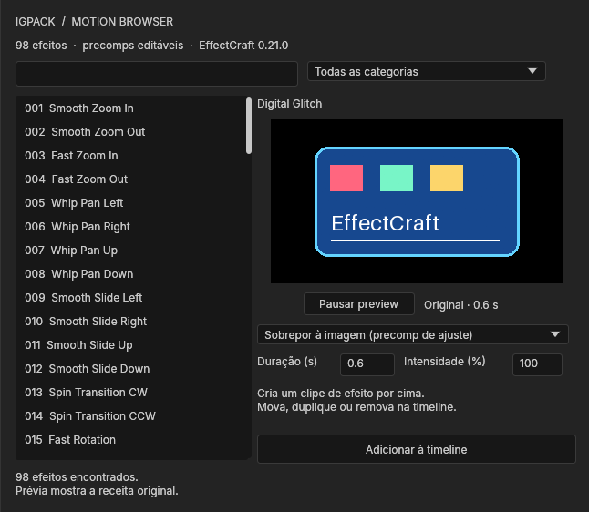

<div align="center">

# IGPACK Motion Browser

**Escolha, veja o preview e coloque o efeito na timeline.**

Painel nativo para **EffectCraft 0.21.0 · Windows**

`98 efeitos` · `Preview animado` · `Precomps editáveis` · `Duração e intensidade` · `MIT`

[Baixar versão 2](https://github.com/igordemello/EffectCraft-Motion-Pack/releases/latest) · [Como funciona](Plugin/README.md) · [Catálogo](Documentation/CATALOG.md) · [Testes do painel](Plugin/Tests/integration_report.json)



*Captura da extensão dentro do EffectCraft. Sem navegador, servidor ou Python para usar.*

</div>

## Instalação

1. **[Baixe o ZIP `IGPACK-Motion-Browser-2.0.0-EffectCraft-0.21.0.zip`](https://github.com/igordemello/EffectCraft-Motion-Pack/releases/latest)** e extraia tudo para uma pasta gravável.
2. **Abra `Install.bat` com dois cliques.** O instalador confirma o CLI 0.21.0 e instala o painel com suas prévias, sem sobrescrever arquivos existentes.
3. No EffectCraft, abra **Janela / Window → IGPACK → Motion Browser**. Reinicie o aplicativo se o menu ainda não aparecer.

A versão 2 abre uma biblioteca nativa dentro do editor. Os presets `.ecpreset` da primeira versão continuam no repositório como fontes e alternativa de uso.

> Se você já instalou o pack v1, pode mantê-lo. O painel v2 usa uma pasta própria e não depende daquela instalação.

## Seu fluxo de edição

**Abra uma composição → escolha o efeito → veja o preview → ajuste duração/intensidade → clique “Adicionar à timeline”.**

| Modo | O que aparece na timeline | Como editar |
|---|---|---|
| **Sobrepor à imagem** | Uma precomp de ajuste por cima da imagem, com entrada e saída na duração escolhida | Mova, duplique ou remova o clipe; ajuste os efeitos na camada externa |
| **Animar seleção** | Uma nova precomp com suas camadas selecionadas e a animação aplicada | Abra a precomp para editar texto, imagens e elementos originais |

O efeito começa na posição do cursor. A duração se ajusta aos frames da composição; a intensidade aceita **0–200%**. Uma aplicação vira um único **Undo**. Se a aplicação falhar, o painel desfaz as alterações parciais.

O preview mostra a receita original. Os ajustes de duração e intensidade são aplicados ao inserir o efeito; o painel não renderiza uma nova prévia personalizada.

### Exemplos

- **Glitch, flash ou shake sobre o vídeo:** use **Sobrepor à imagem**, clique para adicionar e posicione o clipe de efeito sobre o trecho desejado.
- **Título com bounce:** selecione seu texto, escolha **Text Bounce In** e use **Animar seleção**. O texto permanece editável dentro da nova precomp.
- **Logo ou grupo de elementos:** selecione as camadas, escolha um pop/scale e use **Animar seleção**. O pivô é calculado a partir dos limites do conteúdo.

Uma precomp transparente, sozinha, não modifica a imagem abaixo. Por isso o modo de sobreposição usa a propriedade nativa de **camada de ajuste** na precomp externa. A precomp interna contém somente a cobertura; os efeitos ficam na camada da timeline. Ao reutilizar, duplique esse clipe na timeline em vez de arrastar a composição de cobertura do painel Projeto.

## Biblioteca

| Categoria | Quantidade |
|---|---:|
| Transitions | 25 |
| Camera Shake & Motion | 15 |
| Glitch & Distortion | 13 |
| Text Animations | 15 |
| Pop, Bounce & Scale | 15 |
| Blur, Flash & Glow | 15 |
| **Total** | **98** |

O [catálogo dos 100 efeitos planejados](Documentation/CATALOG.md) identifica também os dois RGB Split uniformes que continuam pendentes. Nenhum arquivo vazio foi criado para completar a contagem.

## Testado no aplicativo

| Verificação | Resultado |
|---|---|
| Aplicação pelo botão real de ScriptUI | **98 receitas aprovadas**, com duração de 150% e intensidade de 75% |
| Busca, categorias, timer e pausa/fechamento | Controles e avanço dos quadros verificados |
| Composição de overlay | Imagens antes, durante e depois confirmam que o efeito atua somente no intervalo |
| Movimento do clipe | Parâmetros e expressões acompanham a nova posição na timeline |
| Interface desktop real | Painel instalado e acoplado, preview animado, overlay, precomp de texto e Undo verificados |
| GPU da instância desktop | **AMD Radeon RX 7600, Vulkan**; três receitas amostradas |
| Instalação e remoção | Perfil isolado; colisões recusadas e arquivos editados preservados |

Os [testes do painel](Plugin/Tests/integration_report.json) e o [relatório desktop](Plugin/Tests/desktop_report.json) registram o escopo. A validação original das receitas, com **588 cenários** horizontal/vertical a 24/30/60 FPS, está no [relatório do pack v1](Documentation/TEST_REPORT.md).

Não houve teste de toda a biblioteca em GPU, exportação de todos os frames ou certificação com filmagem comercial. Os testes usaram uma configuração isolada; sua instalação normal não foi alterada.

## Instalação personalizada e remoção

O instalador usa `EFFECTCRAFT_CONFIG_DIR`, quando definida. Caso contrário, detecta a instalação portátil ou usa **`%APPDATA%\EffectCraft`**. O painel fica em `Scripts\ScriptUI Panels\IGPACK\Motion Browser.jsx`; as prévias ficam em `IGPACK Motion Browser\Frames`.

```powershell
# CLI instalado em outro local
.\Install.bat -CliPath "D:\Apps\EffectCraft\effectcraft-cli.exe"

# Configuração personalizada — use a mesma pasta do aplicativo
.\Install.bat -ConfigDir "D:\EffectCraftData"
```

Para remover o painel, execute **`Uninstall.bat`**. Arquivos personalizados são preservados; se houver alterações, mova esses arquivos para outro local e execute novamente para concluir.

**Uso legado:** `Install-Presets.bat` e `Uninstall-Presets.bat` gerenciam somente os arquivos `.ecpreset` da primeira versão. Não são necessários para usar o painel.

## Limites e dicas

- O navegador aplica com um clique. Não há drag-and-drop da lista: depois de adicionar, mova o clipe na timeline.
- Para ter mais espaço, aumente o painel ou desacople sua aba pelos controles nativos do editor. Em docks estreitos, o layout muda para coluna.
- Sobreposições afetam a composição abaixo, dentro do intervalo do clipe. O painel não monta automaticamente duas tomadas nem reposiciona cortes.
- A duração precisa caber depois do cursor. Aumentar o tamanho do clipe manualmente depois de inserido não redistribui suas chaves automaticamente.
- Precomps de seleção aceitam camadas 2D desbloqueadas. Inclua também as camadas ligadas por parenting/track matte; dependências parciais são recusadas para preservar o projeto.
- A precomposição segue as regras nativas do editor: confira expressões que referenciam camadas fora da seleção, pois o contexto de `thisComp` muda.
- Shakes e transformações podem revelar bordas. Aumente a escala da filmagem quando necessário.
- Texto anima como camada inteira. VHS é uma aproximação visual; Pixel Distortion usa blocos/faixas. RGB Split uniforme permanece pendente.
- A intensidade preserva os fades de opacidade; `0%` não elimina necessariamente uma entrada/saída por fade.
- As prévias usam 13 PNGs por receita; o timer do ScriptUI tem limite nativo de atualização. Elas não substituem a reprodução final do projeto.

## Fontes e desenvolvimento

- [`Plugin/Browser.template.jsx`](Plugin/Browser.template.jsx): interface, composição, retiming e aplicação.
- [`Tests/build_plugin.py`](Tests/build_plugin.py): gera o JSX distribuível, as prévias PNG e o manifesto.
- [`Scripts/Manage-Plugin.ps1`](Scripts/Manage-Plugin.ps1): instalação com verificação de versão e hashes.
- [`Plugin/README.md`](Plugin/README.md): arquitetura e instruções detalhadas.

Para reconstruir e testar, use Python 3.10+, Pillow e o CLI 0.21.0:

```powershell
python -m pip install Pillow
python Tests/build_plugin.py
python Tests/test_plugin.py
python Tests/package_plugin.py
```

O teste desktop tem instruções próprias em [`Tests/test_plugin_desktop.py`](Tests/test_plugin_desktop.py) e exige uma instância isolada do aplicativo. A geração e os testes regravam os próprios artefatos; use uma cópia se os personalizou.

## Licença

Código e receitas originais sob [MIT](LICENSE.txt). O painel usa APIs públicas de scripting e efeitos nativos do [EffectCraft 0.21.0](https://github.com/storytold/effectcraft), sem modificar o executável nem copiar arquivos de bibliotecas proprietárias. Veja [atribuição e licenças](Documentation/ATTRIBUTION.md).

Projeto independente, sem vínculo ou endosso do EffectCraft ou do Mister Horse.
